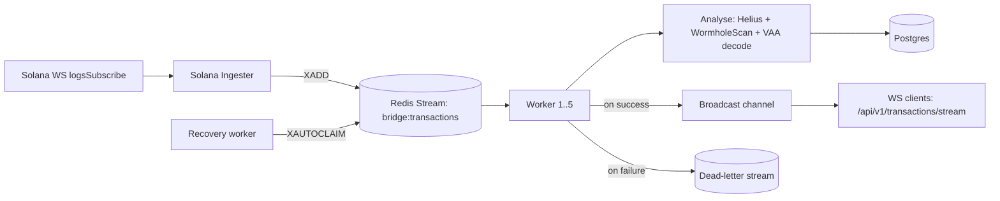
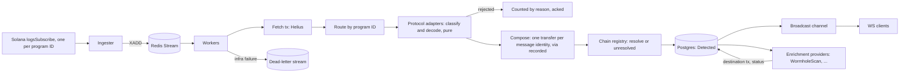
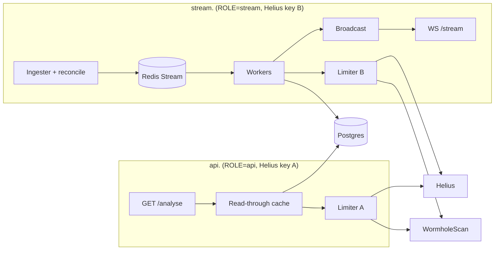
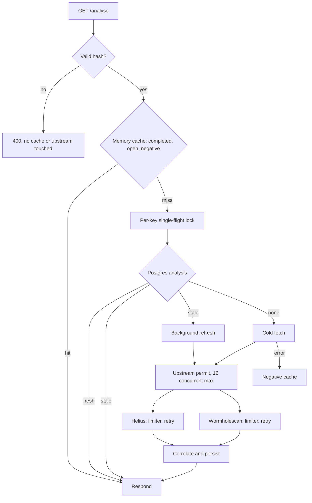

# bridgeIndexer

A real-time indexer for bridge transactions on Solana. It decodes bridge
activity straight from Solana data, in both directions (sends out of Solana,
redeems and solver fills into it), across the major bridge protocols on Solana.
Each transfer is persisted from on-chain data alone, enriched afterwards with
its counterpart leg and final status from protocol APIs, and streamed live to
clients over WebSocket.

The product is moving from a Wormhole transfer indexer to a protocol-agnostic
core with one adapter per bridge protocol (see [Principles](#principles)).
Today only the Wormhole Token Bridge is indexed, and detection still depends on
WormholeScan. The [Roadmap](#roadmap) tracks the move.

## Status

| Area | State |
| --- | --- |
| Wormhole Token Bridge (WTT) | Outbound is indexed chain-first (`Detected` from Solana data alone, WormholeScan enriches). Inbound redeems: A1b |
| Detection | **Chain-first for Wormhole outbound (A5).** A transfer decoded from Solana data is persisted as `Detected` with WormholeScan fully unavailable. WormholeScan only enriches. Transactions no adapter recognises (inbound redeems, other Wormhole programs) still go through the WormholeScan-gated path until their adapters land |
| Domain model and schema | **Generalised (A2).** `bridge_transfers` is identified by `(protocol, message_key)` with `direction`, `via`, raw chain references plus an optional resolved chain, and `NUMERIC(78,0)` amounts. Wormhole fields live in `wormhole_messages`. The pipeline still writes only Wormhole sends out of Solana (A5 wires the adapter) |
| Chains | Registry tables, loader and the SQL `resolve_chain` function exist. Transfers store the raw `(protocol, id)` and the resolved `chains.id`, or NULL when unknown. The pipeline still uses the hardcoded `ChainId` enum. Moving callers off it is the rest of A3 |
| Protocol core | `BridgeAdapter`, `ProtocolRegistry`, `compose`, pure `SolanaTx` and the Wormhole Token Bridge outbound adapter are **wired into `analyse_tx`** through `AppState.protocols`. Inbound redeems (A1b) and the other Wormhole programs (A4) are not decoded yet |golden tests wait for captured fixtures, A9). Inbound redeems are `Unsupported` until A1b. **Not wired into the pipeline yet** |
| Read path (`/analyse`) | Working, cache-hit throughput measured (see [Results](#results)) |
| Destination tx resolution | **Fixed (A5b).** Read from the `/operations` payload (`targetChain.transaction.txHash`, legacy paths as fallback), then `/global-tx` through the WormholeScan limiter when the VAA matched but no destination tx is present. `Pending` now means WormholeScan itself has no destination tx |
| Enrichment | **Provider and background pass (A5b).** WormholeScan sits behind the `EnrichmentProvider` trait in `enrichment/`. A supervised worker re-enriches `Detected` and `Pending` rows on a schedule, so statuses converge without anyone calling `/analyse` |
| WebSocket ingestion | **Lossy**: misses transactions, no measurement yet. It also runs only while a `/stream` client is connected, so the database is not a complete record. Fix is Phase A (always-on) and Phase 4 (recall) |
| CI | `cargo fmt --check`, `clippy -D warnings` and `cargo test` on every PR and on `main` (Phase 0) |
| Deploy | Manual (`git clone` + `cargo run` on EC2, Postgres on RDS). Automated in Phase 2 |

## Principles

1. **The chain is the source of truth.** Detection and decoding come from
   Solana data (Helius), never from an explorer. WormholeScan and any other
   protocol API are enrichment only (destination tx, final status). A
   transaction is persisted as `Detected` from on-chain data alone, even when
   no enrichment exists yet. Enrichment is cross-checked: a WormholeScan VAA is applied only when its emitter
   chain, emitter address and sequence match the message decoded on chain, otherwise
   it is ignored.
2. **Protocol-agnostic core, per-protocol adapters.** Each adapter declares its
   program IDs, classifies and decodes a Solana transaction into a bridge event
   (or rejects it: many transactions that touch a bridge program are admin or
   attest calls, not transfers), and optionally resolves the counterpart.
3. **Composition is real.** Mayan runs on Wormhole and CCTP, and aggregators
   route through other bridges. One transfer can carry an outer protocol and an
   underlying rail. The underlying transfer is indexed once, the router is
   recorded as an attribute (`via`), and nothing is double-counted.
4. **Direction matters.** Solana-outbound sends and Solana-inbound
   redeems/fills (including solver fills for intent bridges) are both indexed.
5. **Unknown is not an error.** An unrecognised chain ID never crashes the
   pipeline or drops a transfer. It is stored as `unresolved(protocol, id)`.

### Protocol coverage

| Protocol | State |
| --- | --- |
| Wormhole Token Bridge (WTT) | Indexed, gated on WormholeScan (Phase A removes the gate) |
| Wormhole NTT and other Wormhole programs on Solana | Phase A, after program IDs and layouts are verified |
| Mayan (Swift, MCTP), Circle CCTP, LayerZero/Stargate, deBridge, Allbridge, Hyperlane, Chainlink CCIP, Across | Candidates. Inclusion and order come from DefiLlama bridge volume for Solana at the start of each phase. Program IDs and instruction/event layouts are verified against official docs or source before an adapter is written |

### Domain model and chain registry (target)

* A transfer carries `protocol`, an optional `via` (outer router), `direction`,
  source and destination chain references, a protocol-specific message identity
  (Wormhole emitter/sequence, CCTP domain/nonce, LayerZero GUID, deBridge order
  ID, ...) with a unique key per protocol, wallets, token, amount and a status:
  `Detected`, `Pending`, `Completed`, plus `Failed`/`Refunded` where a protocol
  needs them.
* Storage is split into a protocol-agnostic `bridge_transfers` table and one
  detail table per protocol (`wormhole_messages` today). A transfer's identity is
  `UNIQUE (protocol, message_key)`. `observed_tx_hash` is the Solana tx it was decoded
  from and `event_index` its position there, so one tx can hold several transfers.
* Chains live in a DB-backed registry: a canonical `chains` table plus a
  `(protocol, protocol_chain_id) -> chain` mapping table, because every protocol
  numbers chains differently (Wormhole chain IDs, CCTP domains, LayerZero
  endpoint IDs, EVM chain IDs, deBridge IDs). Unknown IDs are persisted as
  `unresolved(protocol, id)`.
* Later upgrade, designed now and built later: an unresolved ID can be looked up
  with a free LLM API. The answer is a proposal, never a fact. It enters the
  registry as `pending_review` and activates automatically only when it can be
  cross-checked against an authoritative source (Wormhole chain list, Circle's
  CCTP domain list, LayerZero endpoint metadata). Lookups are rate-limited and
  cached, one per unresolved `(protocol, id)`, with a negative cache.

Implemented so far (no pipeline wiring yet):

* `MessageId` is an enum with one variant per protocol (only `Wormhole` today).
  `MessageId::key()` is the canonical string stored as `bridge_transfers.message_key`,
  unique per `(protocol, message_key)`.
* `BridgeAdapter` is pure: `classify(&SolanaTx)` returns either the transfers it
  contains or a `Reject` of kind `not_transfer`, `unsupported` or `malformed`, with a
  reason. `ProtocolRegistry` routes a tx to every adapter whose program appears
  top-level **or in an inner instruction**, so an aggregator and its underlying rail
  both see it, and `compose()` merges them into one transfer with `via` recorded.
* Amounts are `RawAmount`, a decimal string validated for `NUMERIC(78,0)` (fits a `u256`).
* Adapters emit a `RawChainRef` in the protocol's own namespace. `chains::Snapshot`
  resolves it to a canonical chain, or to `ChainRef::Unresolved`, never an error.
  Only `active` rows resolve, in both tables, and a mapping must point at an active
  chain, so a `pending_review` proposal can never label a real transfer.
* The migration seeds the 10 current chains plus the `wormhole` namespace (checked
  against `sdk/vaa/structs.go` in wormhole-foundation/wormhole) and the `evm`
  namespace (checked against ethereum-lists/chains). Each mapping row carries
  `status`, `origin` (`seed`, `manual`, `llm`), `evidence` and `verified_at`, which is
  the provenance the later LLM-proposal upgrade needs.
* `protocols::wormhole::WormholeAdapter` decodes Token Bridge outbound transfers
  (`transfer_native`, `transfer_wrapped` and the with-payload variants) from the tx
  alone. The Token Bridge CPIs the core bridge `PostMessage`: its instruction data
  carries the payload (amount, token, recipient, destination chain), its emitter
  account and the `Sequence: N` log give the message identity. A tx with
  `meta.err` set, a log/instruction mismatch or a bad payload is rejected with a
  reason, never guessed. The amount is the VAA amount (at most 8 decimals).
  Program IDs are from Wormhole's contract address reference, instruction indexes
  and layouts from `solana/modules/token_bridge` and `solana/bridge`.
* The A2 migration (`20261018120000_generalise_bridge_transfers.sql`) rewrites existing
  rows in place: every legacy row becomes `protocol = 'wormhole'`, `direction = 'Outbound'`,
  with the same message key `MessageId::key()` builds. Chains are stored as the protocol's
  raw reference (`*_ref_protocol`, `*_ref_id`) plus `*_chain_id`, which `resolve_chain()`
  fills when the registry knows the chain. An unknown ID stays unresolved, and a partial
  index finds those rows when a mapping is activated later. An amount that is not a plain
  integer becomes NULL (the full value stays in `analysis`). There is no down migration:
  snapshot the database before deploying.
* `services::detect` turns adapter output into the API's `BridgeTransfer` with status
  `Detected`, then `apply_wormholescan` raises it: `Pending` when a matching VAA exists,
  `Completed` when the destination tx is known. No VAA, a failed WormholeScan call or a
  VAA for another message leaves the transfer `Detected`. Token symbol and decimals are
  a best-effort lookup with a 2 s timeout. The upsert never moves a status backwards
  (`Completed` stays, `Pending` is not overwritten by `Detected`), and the cached
  analysis follows the same rule.

## Architecture

### Current (v0)



Every successfully analysed transaction is persisted to Postgres and, in the
same step, broadcast to any connected WebSocket clients — so the live feed and
the durable record come from a single source of truth, not two separate paths
that can drift.

Two properties of v0 that Phase A changes: the ingester starts when the first
`/stream` client connects and stops after the last one leaves, and `analyse_tx`
needs a WormholeScan operation with a VAA before it will produce anything to
persist.

### Target architecture (Phase A)

Detection and decoding use Solana data only. Enrichment runs after the transfer
is already stored, and a failed or empty enrichment never blocks persistence.



### Target architecture (after Phase 2)

Helius rate limits are per key, so the user-facing read path and the ingestion
pipeline must not share one. The same binary runs in two roles with separate
Helius keys, limiters and hostnames. `ROLE=all` stays available for local dev.



## Project structure

Entries marked *(planned)* arrive with Phase A and later; everything else exists today.

```text
bridgeIndexer/
├── .github/
│   └── workflows/
│       └── ci.yml                      # fmt, clippy, test (Phase 0)
├── .sqlx/                              # offline query data
├── migrations/
│   ├── 20260912071405_create_bridge_transfers.sql
│   ├── 20260912162718_create_indexer_state.sql
│   ├── 20260912232059_fix_indexer_state_key_name.sql
│   ├── 20261002150000_analysis_and_read_indexes.sql
│   ├── 20261017090000_chain_registry.sql
│   └── 20261018120000_generalise_bridge_transfers.sql
├── scripts/
│   └── capture_fixtures.sh             # save Helius + WormholeScan fixtures (Phase 0)
├── src/
│   ├── main.rs                         # wiring, supervised workers, HTTP server
│   ├── lib.rs
│   ├── config.rs                       # env config
│   ├── state.rs                        # AppState, limiters, caches
│   ├── error.rs                        # AppError -> HTTP responses
│   ├── shutdown.rs                     # SIGTERM / Ctrl+C
│   ├── bin/                            # (planned)
│   │   ├── replay.rs                   # status agreement vs WormholeScan (Phase 1)
│   │   └── reconcile.rs                # stream recall vs getSignaturesForAddress (Phase 4)
│   ├── domain/                         # types only, no IO
│   │   ├── bridge.rs
│   │   ├── bridge_transfer.rs
│   │   └── transaction.rs
│   ├── vaa/
│   │   └── decode.rs                   # VAA, address and amount decoding (pure)
│   ├── normaliser/                     # raw provider JSON -> domain (pure)
│   │   ├── solana.rs
│   │   └── wormhole.rs
│   ├── clients/                        # provider HTTP + rate limiting
│   │   ├── helius.rs
│   │   ├── wormhole.rs
│   │   └── limiter.rs
│   ├── chain_adapters/                 # token metadata (destination lookups moved to enrichment/, `find_transaction` is unused and goes with the A3 `ChainId` cleanup)
│   │   ├── mod.rs                      # ChainAdapter trait
│   │   ├── registry.rs
│   │   ├── setup.rs
│   │   ├── solana.rs
│   │   └── wormholescan.rs
│   ├── protocols/                      # protocol-agnostic core (Phase A, partly done, not wired)
│   │   ├── mod.rs                      # BridgeAdapter trait, Protocol, MessageId, Direction, DetectedTransfer, Reject
│   │   ├── registry.rs                 # program ID -> adapters, SOLANA_BRIDGE_PROGRAMS override parser
│   │   ├── compose.rs                  # one transfer per message identity, router recorded as via
│   │   ├── solana_tx.rs                # pure SolanaTx view built from Helius jsonParsed
│   │   ├── amount.rs                   # RawAmount: decimal string for NUMERIC(78,0)
│   │   └── wormhole/                   # Token Bridge adapter, outbound (A1); NTT and other programs planned
│   │       └── mod.rs
│   ├── chains/                         # DB-backed chain registry (Phase A, loader done, not wired)
│   │   ├── mod.rs                      # RawChainRef, ChainRef, Snapshot, resolve (only active rows resolve)
│   │   └── db.rs                       # load_snapshot from Postgres
│   ├── enrichment/                     # counterpart and status providers (Phase A)
│   │   ├── mod.rs                      # EnrichmentProvider trait, EnrichInput, EnrichOutcome
│   │   ├── wormholescan.rs             # WormholeScan: /operations VAA, then /global-tx destination tx
│   │   └── reenrich.rs                 # background pass over Detected and Pending rows
│   ├── ingestion/                      # Solana WS listener + backfill
│   │   ├── solana.rs
│   │   ├── on_demand.rs                # runs the ingester only while /stream clients are connected (replaced in Phase A)
│   │   └── types.rs
│   ├── redis/                          # stream producer, consumer group, recovery
│   │   ├── producer.rs
│   │   └── consumer.rs
│   ├── services/                       # orchestration
│   │   ├── analyzer.rs                 # analyse_tx (split into fetch/decode/enrich in Phase 1)
│   │   ├── correlator.rs
│   │   ├── token_metadata.rs
│   │   ├── detect.rs                   # chain-first detection and WormholeScan enrichment (pure)
│   │   └── read_through.rs             # caches, single-flight, stale-while-revalidate
│   ├── db/
│   │   ├── connection.rs
│   │   └── repository.rs
│   ├── handler/                        # HTTP and WS handlers
│   │   ├── analyse.rs
│   │   └── stream.rs
│   ├── routes/
│   │   ├── mod.rs                      # router + CORS
│   │   └── v1/
│   │       ├── mod.rs
│   │       └── transactions.rs
│   └── util/
│       └── explorer.rs                 # explorer URLs per chain
├── tests/
│   ├── chain_registry_db.rs            # testcontainers Postgres: seed, resolve, status rules
│   ├── common/                         # shared test helpers (container setup)
│   ├── decode_unit.rs                  # pure decode tests (Phase 0)
│   ├── fixtures_decode.rs              # decoders over captured fixtures (Phase 0)
│   ├── persistence_idempotency.rs      # testcontainers Postgres
│   └── fixtures/                       # helius_<name>.json, wormhole_<name>.json (none captured yet)
│   ├── bridge_transfers_schema.rs      # A2 schema and migration of existing rows (needs Docker)
├── benches/                            # (planned) criterion: pure decode (Phase 1)
├── .env.example                        # (Phase 0)
├── .dockerignore
├── .gitignore
├── Cargo.toml
├── Cargo.lock
├── docker-compose.yml
├── dockerfile
└── README.md
```

### Why Redis Streams, not Kafka

Consumer groups plus `XAUTOCLAIM` give exactly the guarantees this needs —
at-least-once delivery, per-worker ack tracking, automatic redelivery of
stuck messages — without a second infrastructure dependency to operate.
Kafka would be the right call at higher throughput or with multiple
independent consumer applications; for a single-service pipeline at this
scale it's added operational cost for guarantees Redis Streams already
provides.

## Read path: `GET /api/v1/transactions/analyse`

A cold analysis is expensive: Helius and Wormholescan are called in parallel,
the VAA is decoded, and the transfer is correlated with its destination chain
(about 360 ms median, and both providers rate-limit). The read path exists so
that almost no request pays that cost.



| Layer | What it does |
| --- | --- |
| Hash validation | Rejects anything that isn't a 64-byte base58 Solana signature before any cache or upstream call. |
| Memory cache (moka) | `completed` transfers for 10 min, `open` (Pending/Detected) for 15 s, `not_found` for 30 s, transient upstream failures for 2 s. |
| Single-flight lock | One request per transaction hash does the work; concurrent requests for the same hash wait, then re-check memory. 50 concurrent requests for one uncached hash cause 1 upstream fetch. |
| Postgres | `bridge_transfers.analysis` holds the last analysis. Completed transfers are always fresh; Pending/Detected ones are fresh for 60 s. |
| Stale-while-revalidate | A stale row is served immediately and refreshed in the background (max 8 refreshes at once, 15 s cooldown per key). A failed refresh only logs; the stale copy keeps being served. |
| Rate limiting | One limiter per provider (`governor`), so retries can't exceed a provider's quota. A call waits at most 2 s for a token, then fails fast with a 503. |
| Retries | 429, timeout and 502 retry up to 3 times with exponential backoff and jitter, each attempt going back through the limiter. |
| Concurrency cap | A semaphore bounds concurrent cold fetches (16); waiting for a permit times out after 2 s with a 503. |

Steady-state upstream load is roughly `hot keys ÷ freshness window`. With the
60 s window, 769 hot Pending transfers need about 13 refreshes per second,
which has to stay under the configured provider quotas.

### Tuning

| Setting | Where | Default |
| --- | --- | --- |
| Freshness window for non-Completed rows | `FRESH_SECS` in `services/read_through.rs` | 60 s |
| Max background refreshes | `MAX_BACKGROUND_REFRESHES` in `services/read_through.rs` | 8 |
| Cache TTLs and capacities | `ReadThrough::new` | see table above |
| Provider quotas | `AppState::new` (`helius_limiter`, `wormhole_limiter`) | 40/s and 20/s, set these just under your plan limits |

## Reliability properties

* **At-least-once processing, exactly-once persistence.** Redis Streams
  guarantees at-least-once delivery; Postgres upserts on `hash` and
  `(protocol, message_key)` absorb redelivery, so a crash mid-batch can never
  double-write, for every protocol.
* **Dead-letter queue.** Transactions that fail analysis or persistence after
  retries move to `bridge:transactions:failed` instead of blocking the stream
  or being silently dropped.
* **Self-healing recovery.** A dedicated worker reclaims messages abandoned by
  a crashed consumer via `XAUTOCLAIM` every 30s.
* **Graceful shutdown.** SIGTERM/Ctrl+C stops new work being picked up, lets
  in-flight messages finish, and drains open HTTP/WS connections before exit.
* **Upstream protection on the read path.** Per-provider rate limiters, retries
  with backoff and jitter, a bounded concurrency semaphore, and fail-fast 503s
  with `Retry-After` keep a burst of new transactions from turning into a
  provider ban or an unbounded queue.
* **Failures are cached too.** Not-found results (30 s) and transient upstream
  failures (2 s) are remembered, so one bad hash can't make every request redo
  the full upstream attempt or pile up behind its lock.
* **Stale data beats a slow answer.** Pending transfers past their freshness
  window are served from Postgres while a background task refreshes them
  through the same limiters.
* **Enrichment never gates persistence.** A transfer decoded from Solana data is stored
  as `Detected` even if WormholeScan is down, rate-limited or has no VAA yet, and a status
  never moves backwards.
* **Open transfers converge on their own.** A supervised worker re-enriches `Detected`
  and `Pending` rows every `REENRICH_INTERVAL_SECS`, oldest attempt first, through the
  WormholeScan limiter (it never touches Helius). Rows younger than
  `REENRICH_MIN_AGE_SECS` are left to the normal pipeline, a row is not asked again
  within `REENRICH_RETRY_SECS`, and rows older than `REENRICH_MAX_AGE_SECS` are given up
  on. A pass ends early after three provider outages in a row.

## API

```
GET /api/v1/transactions/analyse?transaction_hash=<hash>&chain=solana
WS  /api/v1/transactions/stream
```

`chain` is the source chain. Solana is currently the only supported source
chain; anything else returns `422 NORMALISATION_FAILED`.

| Status | Code | Meaning |
| --- | --- | --- |
| 200 | | Analysis returned (from cache, Postgres, or a fresh fetch). |
| 400 | `INVALID_TX_HASH`, `BAD_REQUEST` | Malformed hash or request. |
| 404 | `TX_NOT_FOUND`, `VAA_NOT_AVAILABLE` | Transaction doesn't exist, or its VAA isn't available yet. Cached briefly. |
| 422 | `NORMALISATION_FAILED` | Transaction data couldn't be normalised, including unsupported chains. |
| 429 | `UPSTREAM_RATE_LIMITED` | A provider rate-limited the request after retries. Sends `Retry-After: 1`. |
| 502 / 504 | `UPSTREAM_ERROR`, `UPSTREAM_TIMEOUT` | A provider failed or timed out after retries. |
| 503 | `OVERLOADED` | The service is shedding load (limiter or permit wait exceeded 2 s). Sends `Retry-After: 1`. |
| 500 | `INTERNAL_ERROR` | Unexpected error. |

CORS is origin-allowlisted via `ALLOWED_ORIGINS` — nothing is permitted by
default.

## Running locally

Requires Postgres and Redis reachable at the URLs below.

```bash
cp .env.example .env   # fill in RPC URLs and the bridge program address
cargo run
```

Migrations run on startup.

Config notes:

* `HELIUS_LIVE_URL` (optional, falls back to `HELIUS_URL`) is the endpoint for the
  live pipeline. `LIVE_IDLE_GRACE_SECS` and `LIVE_BACKFILL` are also read. None of
  the three is in `.env.example` yet.
* `SOLANA_TOKEN_BRIDGE_PROGRAM` is a single address and is still the only program
  setting `config.rs` reads. `protocols::registry` already has a parser for
  `SOLANA_BRIDGE_PROGRAMS` (a `protocol:program_id` CSV), but nothing reads that
  variable yet. A4 wires it and retires the single-address setting.
* Re-enrichment (all optional): `REENRICH_ENABLED` (default on, `0` disables),
  `REENRICH_INTERVAL_SECS` (30), `REENRICH_BATCH` (50), `REENRICH_MIN_AGE_SECS` (60),
  `REENRICH_RETRY_SECS` (120) and `REENRICH_MAX_AGE_SECS` (7 days).
* The database is Postgres 18. Tests and CI run against 18, not older.

## Testing

```bash
cargo test
```

* `tests/decode_unit.rs` — VAA decoding (hand-built VAAs, malformed input),
  address decoding, amount formatting. No network, no Docker.
* `tests/fixtures_decode.rs` — runs the pure decoders over real captured
  provider responses in `tests/fixtures/`. Capture new ones with
  `scripts/capture_fixtures.sh`.
* `tests/persistence_idempotency.rs` — real Postgres 18 container (via `testcontainers`,
  needs Docker): redelivering the same transaction, the scenario `XAUTOCLAIM` recovery
  guarantees will happen, never produces a duplicate row in `transactions`,
  `bridge_transfers` or `wormhole_messages`.
* `tests/bridge_transfers_schema.rs` — the A2 schema on Postgres 18: legacy rows are
  staged under the old schema and migrated (known and unknown chains, `u128::MAX`,
  non-integer amounts, analysis kept), new writes land in the protocol-agnostic shape,
  several transfers share one observed tx, the database rejects bad `direction` and
  `status`, and SQL `resolve_chain` agrees with the Rust registry. Set
  `TEST_DATABASE_URL` to use a server you already run instead of Docker.
* Unit tests inside `src/protocols/*` and `src/chains/mod.rs`: routing on inner calls,
  override parsing, compose merging, "only active rows resolve", and the Wormhole
  adapter (outbound decode, with-payload, router-made calls, several transfers per tx,
  failed tx, missing or foreign `Sequence` logs, malformed and truncated data).
  No network, no Docker.
* `tests/chain_registry_db.rs` — real Postgres container (needs Docker): the migration
  seeds the ten chains, one chain resolves to one key from every namespace, unknown IDs
  are unresolved, `pending_review` mappings resolve only once activated, the database
  rejects unknown status values, and a failed refresh keeps the previous snapshot.
* Unit tests in `src/clients/wormhole.rs` and `src/services/detect.rs`: transfer mapping,
  missing metadata, foreign chain namespaces, enrichment (no VAA, matching VAA, VAA for
  another message), destination tx path priority, empty or absent values, `Pending` to
  `Completed` only, `Completed` never rewritten, a matching VAA never lowering a status.
  `tests/bridge_transfers_schema.rs` also checks that a later analysis without enrichment
  does not downgrade a stored status.
* Unit tests in `src/enrichment/`: the WormholeScan provider on prefetched responses
  (destination tx completes, mismatched VAA and missing VAA change nothing, "not found" is
  an answer while other errors are not, a `Completed` transfer is never moved backwards)
  and the re-enrichment decision (advanced, unchanged but persisted, unreachable provider
  persists nothing). The due-rows query itself is checked by hand against a migrated
  database, there is no automated test for it.

***

# Roadmap

Every checkpoint follows the same loop:

1. Branch: `feat/…` for features and new protocol adapters, `fix/…` for correctness, `perf/…` for speed, `ci/…` / `chore/…` for infra, `docs/…` for docs-only changes. One change per branch.
2. Tests first or alongside. Fixtures for anything that parses provider data.
3. Run the benchmark for that phase, same workload as the previous tag.
4. Add a row to [Results](#results): version, change, before, after.
5. PR, CI green, merge, tag (`v0`, `v1`, …), deploy.
6. Re-run the benchmark on EC2. Numbers in this README are EC2 numbers; laptop numbers are for iteration only.

Rule for the numbers: two runs, warm and cold kept separate, read the status
code distribution (a 4xx/5xx still counts as "success" in most load tools),
record the git SHA and instance type next to every row.

## Phase 0 — foundation

* \[x] GitHub Actions CI: `cargo fmt --check`, `clippy -D warnings`, `cargo test`
* \[x] Unit tests for VAA decode, address decode, amount formatting
* \[x] Fixture capture script and fixture-driven decode tests (no fixtures are committed yet, so the fixture tests pass vacuously until some are captured)
* \[x] `.env.example`, README drift fixed
* \[ ] Tag `v0` (baseline numbers below)

Exit: CI green on `main`.

## Phase 1 — protocol-agnostic core (metric: correctness)

Problem 1: the product is a Solana bridge transaction indexer, but the code is a
Wormhole transfer indexer. The domain model, schema, chain handling and
detection are all Wormhole-shaped, and detection is gated on WormholeScan.

Problem 2 (fixed in A5b): every transfer reported `Pending`. The destination tx was read from
`globalTx.destinationTx.txHash` on the `/operations` response, which does not
carry that field, and `WormholeScanAdapter::find_transaction` (which hits
`/global-tx/...`) was never called.

Delivery is one protocol per phase. Phase A builds the core with Wormhole as the
only real adapter. Phases B and later add one protocol each.

### Phase A — protocol-agnostic core, Wormhole only

* \[ ] A1. Adapter trait and registry: each adapter declares its program IDs and classifies/decodes a Solana tx into a bridge event, or rejects it with a reason. Decode is pure (no network, no state). Modelled on the existing `chain_adapters` registry. Done: `BridgeAdapter`, `ProtocolRegistry`, pure `SolanaTx` (#3), Wormhole Token Bridge outbound decode. Remaining: A1b inbound redeems (needs the posted VAA account read, so an account preload on `SolanaTx`), and wiring into the worker
* \[x] A2. Generalised domain model and schema: `protocol`, optional `via`, `direction`, source and destination chain references, a protocol-specific message identity with a unique key per protocol, `Detected`/`Pending`/`Completed` plus `Failed`/`Refunded`, `NUMERIC` amounts. `bridge_transfers` (protocol-agnostic) is split from `wormhole_messages`. Existing rows are migrated in place and tested on staged legacy data
* \[ ] A3. DB-backed chain registry: canonical `chains` table plus a `(protocol, protocol_chain_id) -> chain` mapping table, seeded with the current 10 chains, replacing the `ChainId` enum and `from_wormhole_id`. Unknown IDs are stored as `unresolved(protocol, id)`, never dropped and never a crash. The registry carries the status and provenance needed for the later LLM-proposal upgrade, which is not built in this phase... Done: tables, seed, `load_snapshot`, DB tests (#4), SQL `resolve_chain`, and unresolved IDs persisted on transfers (A2). Remaining: move callers off `ChainId` and `from_wormhole_id`, wire the snapshot refresh task
* \[ ] A4. All Wormhole programs on Solana, not only the Token Bridge (Token Bridge, NTT and others, each after its program ID and layouts are verified against official docs or source). One `logsSubscribe` per program ID, since `mentions` accepts a single address, with a checkpoint per program. `SOLANA_TOKEN_BRIDGE_PROGRAM` is replaced by a configured list
* \[x] A5. Chain-first detection: a transfer is persisted as `Detected` from Helius data alone. WormholeScan is an enrichment that fills the status and no longer gates persistence. Done for Wormhole outbound in `analyse_tx` (`services::detect`), cross-checked against the on-chain message ID. Done (A5b): the destination tx fix, the WormholeScan lookups behind an `EnrichmentProvider` in `enrichment/`, and a background re-enrichment pass (`enrichment::reenrich`) that moves `Detected` and `Pending` rows forward. Several transfers per tx are decoded but only the first is stored until the v2 model
* \[ ] A6. Composition: one transfer per message identity, the outer protocol or router recorded as `via`, and a test that an outer and an underlying adapter seeing the same tx produce one row... Partly done (#3): `compose()` with unit tests. The end-to-end outer+underlying test waits for a second adapter
* \[ ] A7. Direction: Solana-outbound sends and Solana-inbound redeems both indexed. Outbound decode done for the Token Bridge. Inbound comes with A1b
* \[ ] A8. Ingestion is always on, in this phase and every later one, and no longer tied to `/stream` clients, so the database is a complete record of what the programs emitted. Helius usage is kept in check by a configurable ingestion budget (limiter, dedupe of repeated signatures, backfill pacing)
* \[ ] A9. Fixtures captured from real txs (outbound, inbound, admin/attest rejected, unsupported variant) and golden tests per adapter
* \[ ] A10. API versioning: `/api/v2` serves the generalised model (protocol, direction, via, chain references, all transfers of a tx). `/api/v1` keeps its current Wormhole-shaped response through a compatibility mapper until it is retired. Amounts are stored as `NUMERIC` so volume can be aggregated

Benchmarks: classification precision on the fixture set; pure classify ns/op (criterion).
Exit: Wormhole transfers are persisted as `Detected` with WormholeScan fully unavailable; every non-transfer fixture is rejected with a reason; the migration is tested on staged existing rows (done in A2).

### Phase B and later — one protocol per phase

Each phase adds one protocol, in descending order of Solana bridge volume, and
follows the same steps:

1. Derive the current ranking from DefiLlama bridge data for Solana. Nothing is hardcoded from memory.
2. Verify the protocol's program IDs and instruction/event layouts against its official docs or source.
3. Capture fixtures from real transactions (`scripts/capture_fixtures.sh`) and write golden tests, including admin/attest transactions that must be rejected.
4. Write the adapter, its enrichment provider if the protocol has an API, and its chain-ID mappings for the registry.
5. Cover composition with any protocol already indexed (Mayan over Wormhole and CCTP, aggregators over everything).

Candidates to evaluate: Mayan (Swift, MCTP), Circle CCTP, LayerZero/Stargate,
deBridge, Allbridge, Hyperlane, Chainlink CCIP, Across. The ranking decides
which of these actually ship and in what order.

### Later upgrade — unknown-chain resolution (design now, build later)

Out of scope for the first delivery. Phase A only ships the registry shape and
the `unresolved` handling. The constraints the design has to satisfy:

* LLM output is a proposal, not a fact. It is written to the registry as `pending_review` and auto-activated only when it can be cross-checked against an authoritative source (Wormhole chain list, Circle's CCTP domain list, LayerZero endpoint metadata). An unverified guess never labels real transfers.
* Lookups are rate-limited and cached, one per unresolved `(protocol, id)`, with a negative cache.
* Activating a mapping resolves the transfers already stored as `unresolved` for that `(protocol, id)`.

### Remaining Phase 1 items

Provider lanes, replay and the decode bench stay in this phase. Items 1a, 1b and
1d are delivered by Phase A (1a by A1, 1b by A5, 1d by A9).

* \[ ] 1a. Split `analyse_tx` into fetch (IO), decode (pure, no network or state), enrich (IO). Delivered by A1
* \[x] 1b. Destination tx resolution: operation payload paths first, then the `global-tx` lookup through the WormholeScan limiter. Delivered by A5b, as the WormholeScan enrichment provider
* \[ ] 1c. Provider lanes: `Lane::Api` and `Lane::Ingest`, each with its own Helius URL (`HELIUS_API_URL`, `HELIUS_STREAM_URL`) and its own limiter. Fall back to `HELIUS_URL` when unset. Today the code has one extra endpoint, `HELIUS_LIVE_URL`, and `AppState::for_live` for the live pipeline. This item replaces it
* \[ ] 1d. Golden tests per fixture, status matrix test (known tx → `Completed`, none + registered chain → `Pending`, unregistered → `Detected`). Delivered by A9, with the matrix redefined for on-chain-first statuses
* \[ ] 1e. `src/bin/replay.rs`: take the last N signatures, run the pipeline, compare our status with WormholeScan's `global-tx`
* \[ ] 1f. Criterion bench for the pure classify/decode path

Benchmarks: classify/decode ns/op (criterion); replay agreement %, Pending %, errors by kind, cold p50/p99.
Exit: ≥ 99% agreement on transfers older than 15 minutes; `Pending` only when WormholeScan itself has no destination tx.

## Phase 2 — deploy pipeline and roles

* \[ ] `ROLE=api|stream|all`. `api` serves `/analyse`; `stream` runs ingester, workers, recovery and `/stream`. Shared Postgres and Redis
* \[ ] Hostnames `api.<domain>` and `stream.<domain>`, each process with its own Helius key
* \[ ] CI builds the release binary; CD over SSH on merge to `main`: deploy key, one systemd unit per role, health check, rollback to previous binary
* \[ ] `/health` (Postgres and Redis ping) and metrics: request latency histogram, cache hit/miss counters, limiter wait time, stream lag
* \[ ] Hardening: compose publishes Postgres/Redis on `127.0.0.1` only, no default credentials on a public box, security group allows only 80/443 and SSH from a fixed IP
* \[ ] Load generator on a second instance in the same VPC, larger than the `t3.micro` used for v0

Exit: merge to `main` deploys both roles; the API benchmark runs against the deployed service.

## Phase 3 — scale the API (reads and writes)

Measure before changing anything. Each item is one tagged experiment with the same workloads.

* \[ ] 3a. True server ceiling: re-run `R-hit` with a stronger load generator; profile (samply / `perf`, `tokio-console`); explain the 33–45 ms latency cluster
* \[ ] 3b. `v1` cache pre-serialized response bytes instead of cloning `NormalisedTransaction` and re-serializing per hit
* \[ ] 3c. `v2` one cache lookup instead of four
* \[ ] 3d. `v3` two API instances behind a proxy: per-process caches duplicate refreshes; compare a Redis-shared cache against sticky routing
* \[ ] 3e. Cold path: fake upstream server replaying fixtures with injected latency and 429s so quota isn't burned; try JSON-RPC batching for Helius, priority for user requests over background refresh, limiters set to the real plan limits
* \[ ] 3f. Write path: consumer throughput against the fake upstream. Try larger `XREADGROUP COUNT`, concurrent processing inside a worker, batched upserts per Postgres transaction, pool sizing against RDS limits
* \[ ] 3g. List endpoint using the `idx_bt_*` indexes with keyset pagination, benchmarked on ~1M seeded rows with `EXPLAIN ANALYZE`

Exit: documented ceiling for each workload and what limits it (CPU, Postgres, provider quota).

## Phase 4 — WebSocket stream (metric: recall and precision)

First build `src/bin/reconcile.rs`. Ground truth is per program: for each
subscribed program ID and a time window, take `getSignaturesForAddress` as the
set of transactions that touched the program, run the adapter's pure classifier
over them offline, and diff the ones classified as transfers against the
database. Report, per program: missed count, missed %, and ingestion lag (block
time → published).

Recall alone is not enough, because many transactions that touch a bridge
program are admin or attest calls. The same run also reports classification
precision: of the transactions we persisted as transfers, the share confirmed
by an independent source (the protocol's own API, or a hand-labelled sample),
plus the rejection counts by reason. That is the stream's `v0`.

Known suspects, most likely first:

1. Checkpoint is slot-granular and backfill stops at `slot <= checkpoint`, so other transactions in the checkpoint's slot are lost on any reconnect
2. Backfill runs before the read loop with a 150 ms sleep per signature, so live notifications queue up behind it
3. No keepalive or watchdog: a silently dead socket produces neither errors nor data
4. A rejected `logsSubscribe` is swallowed (the check is unreachable), and any publish error tears down the connection
5. The ingester is not under `spawn_supervised`, so a panic stops it permanently
6. The checkpoint is written on every message and can move backwards on out-of-order slots

Work items:

* \[ ] 4a. `reconcile` bin: per-program recall, classification precision, and baseline over 24 h
* \[ ] 4b. Rewind the checkpoint a few slots on reconnect and dedupe by signature (persistence is already idempotent)
* \[ ] 4c. Backfill as a separate task, concurrent with live reads
* \[ ] 4d. Ping/pong keepalive and a no-message watchdog that forces a reconnect
* \[ ] 4e. Surface subscribe errors, supervise the ingester, `GREATEST` on the checkpoint
* \[ ] 4f. Periodic reconciliation poll as a completeness guarantee: WebSocket is the low-latency path, polling is the safety net
* \[ ] 4g. Evaluate Helius' other streaming options against current docs before building anything custom

Exit: recall ≥ 99.9% for every indexed program over 24 h, classification precision and p99 ingestion lag recorded.

## Out of scope

Ingesting bridge transactions that happen only on other chains. The indexer
decodes what happens on Solana. Other chains appear as counterparties: through
the chain registry and the enrichment providers that resolve the other leg, never
as ingestion targets. This replaces the earlier multi-chain ingestion phase
(Ethereum, BSC and other EVM listeners).

***

# Benchmarks

## Workloads

| ID | What | Tool |
| --- | --- | --- |
| `R-hit` | 769 distinct signatures, warm cache, 50 connections, 30 s | `oha` |
| `R-mix` | 90% hot / 10% cold keys against the fake upstream | `oha` |
| `R-cold` | all-unique signatures against the fake upstream (50 ms latency) | `oha` |
| `R-junk` | invalid hashes, must never reach an upstream | `oha` |
| `W-ingest` | 100k candidates `XADD`ed, fake upstream, measure persisted tx/s and stream lag | custom bin |
| `S-recall` | per-program 24 h reconciliation against `getSignaturesForAddress` | `reconcile` bin |
| `S-precision` | of transactions persisted as transfers, share confirmed by an independent source, plus rejections by reason | `reconcile` bin |
| `D-decode` | pure classify/decode path, ns per operation | `criterion` |
| `C-agree` | status agreement with WormholeScan over the last N signatures | `replay` bin |

Reproducing `R-hit`: build a file with one URL per line (valid Solana
signatures only), then run it twice. The first run fills the cache, the second
is the warm number.

```bash
oha -z 30s -c 50 --urls-from-file urls.txt
```

## Results

Server: `m7i-flex.large` (2 vCPU). Load generator: `t3.micro` in the same VPC,
the first thing to hit 100% CPU. 30 s runs, 50 connections, 769 distinct
transactions, 1.2 KiB responses.

### Baseline (`v0`)

| Workload | Result |
| --- | --- |
| `R-hit` | 36.5k and 37.1k req/s over two runs, 1.1M requests each, every response a 200 |
| `R-hit` latency | about 0.8 ms median, p99 about 33 ms |
| `R-hit`, 200 connections | 33.9k req/s, load generator CPU at 100% |
| Cold burst, 50 concurrent requests for one hash | 1 upstream fetch, all 50 served in a 28 ms window |
| `R-junk` | about 55k req/s of cheap 400s, zero upstream calls |

What these do and don't mean:

* Cache-hit throughput is a lower bound: at 200 connections the load generator was CPU-bound, so the server's ceiling hasn't been measured.
* Uncached transactions are limited by the providers. With the default quotas (40/s Helius, 20/s WormholeScan) that is roughly 20 new lookups per second; overflow gets a 503 after 2 s.
* There is a cluster of 33–45 ms requests that hasn't been explained yet.
* The cache lives in one process, so several instances would each refresh their own copies.

### Phase 1 — correctness

| Version | Change | `C-agree` | Pending % | `D-decode` ns/op | Cold p50 / p99 |
| --- | --- | --- | --- | --- | --- |
| v0 | baseline | — | ~100% (bug) | — | ~360 ms median |
| v1 | | — | — | — | — |

### Phase 2 — deploy pipeline

| Version | Change | Merge → live | Rollback | Health check | Roles deployed |
| --- | --- | --- | --- | --- | --- |
| v0 | manual `git clone` + `cargo run` | — | — | none | 1 (all in one) |
| | | | | | |

### Phase 3 — API reads and writes

| Version | Change | `R-hit` req/s | `R-hit` p99 | `R-cold` req/s | `W-ingest` tx/s | Limited by |
| --- | --- | --- | --- | --- | --- | --- |
| v0 | baseline | 36.5k | ~33 ms | ~20 (quota) | — | load generator |
| | | | | | | |

### Phase 4 — stream

| Version | Change | Program | `S-recall` | `S-precision` | Missed | p99 lag |
| --- | --- | --- | --- | --- | --- | --- |
| v0 | baseline | — | — | — | — | — |
| | | | | | | |
