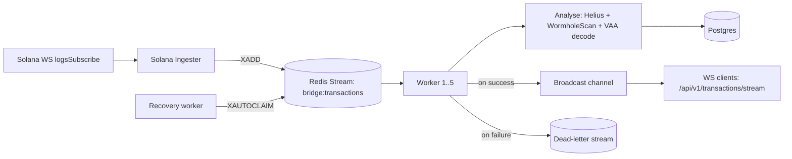
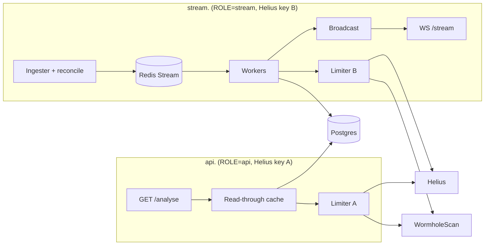
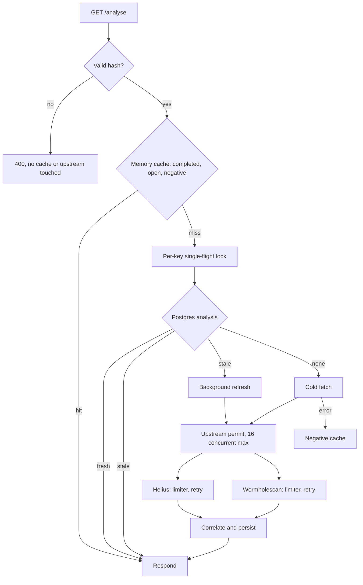

# bridgeIndexer

A real-time indexer for Wormhole cross-chain bridge transfers — watches
each chain's Token Bridge contract, correlates every transfer against its
destination-chain completion, persists it, and streams it live to clients
over WebSocket. Currently indexes Solana, with additional chains landing
incrementally.

## Status

| Area | State |
| --- | --- |
| Read path (`/analyse`) | Working, cache-hit throughput measured (see [Results](#results)) |
| Destination tx resolution | **Broken**: transfers stay `Pending` even when WormholeScan shows them finalized. Fix is Phase 1 |
| WebSocket ingestion | **Lossy**: misses transactions, no measurement yet. Fix is Phase 4 |
| CI | None yet. Phase 0 |
| Deploy | Manual (`git clone` + `cargo run` on EC2, Postgres on RDS). Automated in Phase 2 |

## Architecture



Every successfully analysed transaction is persisted to Postgres and, in the
same step, broadcast to any connected WebSocket clients — so the live feed and
the durable record come from a single source of truth, not two separate paths
that can drift.

### Target architecture (after Phase 2)

Helius rate limits are per key, so the user-facing read path and the ingestion
pipeline must not share one. The same binary runs in two roles with separate
Helius keys, limiters and hostnames. `ROLE=all` stays available for local dev.



## Project structure

bridgeIndexer/
├── .github/
│   └── workflows/
│       └── ci.yml                      # fmt, clippy, test (Phase 0)
├── .sqlx/                              # offline query data
├── migrations/
│   ├── 20260912071405_create_bridge_transfers.sql
│   ├── 20260912162718_create_indexer_state.sql
│   ├── 20260912232059_fix_indexer_state_key_name.sql
│   └── 20261002150000_analysis_and_read_indexes.sql
├── scripts/
│   └── capture_fixtures.sh             # save Helius + WormholeScan fixtures (Phase 0)
├── src/
│   ├── main.rs                         # wiring, supervised workers, HTTP server
│   ├── lib.rs
│   ├── config.rs                       # env config
│   ├── state.rs                        # AppState, limiters, caches
│   ├── error.rs                        # AppError -> HTTP responses
│   ├── shutdown.rs                     # SIGTERM / Ctrl+C
│   ├── bin/                            # (planned)
│   │   ├── replay.rs                   # status agreement vs WormholeScan (Phase 1)
│   │   └── reconcile.rs                # stream recall vs getSignaturesForAddress (Phase 4)
│   ├── domain/                         # types only, no IO
│   │   ├── bridge.rs
│   │   ├── bridge_transfer.rs
│   │   └── transaction.rs
│   ├── vaa/
│   │   └── decode.rs                   # VAA, address and amount decoding (pure)
│   ├── normaliser/                     # raw provider JSON -> domain (pure)
│   │   ├── solana.rs
│   │   └── wormhole.rs
│   ├── clients/                        # provider HTTP + rate limiting
│   │   ├── helius.rs
│   │   ├── wormhole.rs
│   │   └── limiter.rs
│   ├── chain_adapters/                 # destination lookups, token metadata
│   │   ├── mod.rs                      # ChainAdapter trait
│   │   ├── registry.rs
│   │   ├── setup.rs
│   │   ├── solana.rs
│   │   └── wormholescan.rs
│   ├── ingestion/                      # Solana WS listener + backfill
│   │   ├── solana.rs
│   │   └── types.rs
│   ├── redis/                          # stream producer, consumer group, recovery
│   │   ├── producer.rs
│   │   └── consumer.rs
│   ├── services/                       # orchestration
│   │   ├── analyzer.rs                 # analyse_tx (split into fetch/decode/enrich in Phase 1)
│   │   ├── correlator.rs
│   │   ├── token_metadata.rs
│   │   └── read_through.rs             # caches, single-flight, stale-while-revalidate
│   ├── db/
│   │   ├── connection.rs
│   │   └── repository.rs
│   ├── handler/                        # HTTP and WS handlers
│   │   ├── analyse.rs
│   │   └── stream.rs
│   ├── routes/
│   │   ├── mod.rs                      # router + CORS
│   │   └── v1/
│   │       ├── mod.rs
│   │       └── transactions.rs
│   └── util/
│       └── explorer.rs                 # explorer URLs per chain
├── tests/
│   ├── decode_unit.rs                  # pure decode tests (Phase 0)
│   ├── fixtures_decode.rs              # decoders over captured fixtures (Phase 0)
│   ├── persistence_idempotency.rs      # testcontainers Postgres
│   └── fixtures/                       # helius_<name>.json, wormhole_<name>.json
├── benches/                            # (planned) criterion: pure decode (Phase 1)
├── .env.example                        # (Phase 0)
├── .dockerignore
├── .gitignore
├── Cargo.toml
├── Cargo.lock
├── docker-compose.yml
├── dockerfile
└── README.md

### Why Redis Streams, not Kafka

Consumer groups plus `XAUTOCLAIM` give exactly the guarantees this needs —
at-least-once delivery, per-worker ack tracking, automatic redelivery of
stuck messages — without a second infrastructure dependency to operate.
Kafka would be the right call at higher throughput or with multiple
independent consumer applications; for a single-service pipeline at this
scale it's added operational cost for guarantees Redis Streams already
provides.

## Read path: `GET /api/v1/transactions/analyse`

A cold analysis is expensive: Helius and Wormholescan are called in parallel,
the VAA is decoded, and the transfer is correlated with its destination chain
(about 360 ms median, and both providers rate-limit). The read path exists so
that almost no request pays that cost.



| Layer | What it does |
| --- | --- |
| Hash validation | Rejects anything that isn't a 64-byte base58 Solana signature before any cache or upstream call. |
| Memory cache (moka) | `completed` transfers for 10 min, `open` (Pending/Detected) for 15 s, `not_found` for 30 s, transient upstream failures for 2 s. |
| Single-flight lock | One request per transaction hash does the work; concurrent requests for the same hash wait, then re-check memory. 50 concurrent requests for one uncached hash cause 1 upstream fetch. |
| Postgres | `bridge_transfers.analysis` holds the last analysis. Completed transfers are always fresh; Pending/Detected ones are fresh for 60 s. |
| Stale-while-revalidate | A stale row is served immediately and refreshed in the background (max 8 refreshes at once, 15 s cooldown per key). A failed refresh only logs; the stale copy keeps being served. |
| Rate limiting | One limiter per provider (`governor`), so retries can't exceed a provider's quota. A call waits at most 2 s for a token, then fails fast with a 503. |
| Retries | 429, timeout and 502 retry up to 3 times with exponential backoff and jitter, each attempt going back through the limiter. |
| Concurrency cap | A semaphore bounds concurrent cold fetches (16); waiting for a permit times out after 2 s with a 503. |

Steady-state upstream load is roughly `hot keys ÷ freshness window`. With the
60 s window, 769 hot Pending transfers need about 13 refreshes per second,
which has to stay under the configured provider quotas.

### Tuning

| Setting | Where | Default |
| --- | --- | --- |
| Freshness window for non-Completed rows | `FRESH_SECS` in `services/read_through.rs` | 60 s |
| Max background refreshes | `MAX_BACKGROUND_REFRESHES` in `services/read_through.rs` | 8 |
| Cache TTLs and capacities | `ReadThrough::new` | see table above |
| Provider quotas | `AppState::new` (`helius_limiter`, `wormhole_limiter`) | 40/s and 20/s, set these just under your plan limits |

## Reliability properties

* **At-least-once processing, exactly-once persistence.** Redis Streams
  guarantees at-least-once delivery; Postgres upserts on `hash` and
  `(emitter_chain, emitter_address, sequence)` absorb redelivery, so a crash
  mid-batch can never double-write.
* **Dead-letter queue.** Transactions that fail analysis or persistence after
  retries move to `bridge:transactions:failed` instead of blocking the stream
  or being silently dropped.
* **Self-healing recovery.** A dedicated worker reclaims messages abandoned by
  a crashed consumer via `XAUTOCLAIM` every 30s.
* **Graceful shutdown.** SIGTERM/Ctrl+C stops new work being picked up, lets
  in-flight messages finish, and drains open HTTP/WS connections before exit.
* **Upstream protection on the read path.** Per-provider rate limiters, retries
  with backoff and jitter, a bounded concurrency semaphore, and fail-fast 503s
  with `Retry-After` keep a burst of new transactions from turning into a
  provider ban or an unbounded queue.
* **Failures are cached too.** Not-found results (30 s) and transient upstream
  failures (2 s) are remembered, so one bad hash can't make every request redo
  the full upstream attempt or pile up behind its lock.
* **Stale data beats a slow answer.** Pending transfers past their freshness
  window are served from Postgres while a background task refreshes them
  through the same limiters.

## API

```
GET /api/v1/transactions/analyse?transaction_hash=<hash>&chain=solana
WS  /api/v1/transactions/stream
```

`chain` is the source chain. Solana is currently the only supported source
chain; anything else returns `422 NORMALISATION_FAILED`.

| Status | Code | Meaning |
| --- | --- | --- |
| 200 | | Analysis returned (from cache, Postgres, or a fresh fetch). |
| 400 | `INVALID_TX_HASH`, `BAD_REQUEST` | Malformed hash or request. |
| 404 | `TX_NOT_FOUND`, `VAA_NOT_AVAILABLE` | Transaction doesn't exist, or its VAA isn't available yet. Cached briefly. |
| 422 | `NORMALISATION_FAILED` | Transaction data couldn't be normalised, including unsupported chains. |
| 429 | `UPSTREAM_RATE_LIMITED` | A provider rate-limited the request after retries. Sends `Retry-After: 1`. |
| 502 / 504 | `UPSTREAM_ERROR`, `UPSTREAM_TIMEOUT` | A provider failed or timed out after retries. |
| 503 | `OVERLOADED` | The service is shedding load (limiter or permit wait exceeded 2 s). Sends `Retry-After: 1`. |
| 500 | `INTERNAL_ERROR` | Unexpected error. |

CORS is origin-allowlisted via `ALLOWED_ORIGINS` — nothing is permitted by
default.

## Running locally

Requires Postgres and Redis reachable at the URLs below.

```bash
cp .env.example .env   # fill in RPC URLs and the bridge program address
cargo run
```

Migrations run on startup.

## Testing

```bash
cargo test
```

* `tests/decode_unit.rs` — VAA decoding (hand-built VAAs, malformed input),
  address decoding, amount formatting. No network, no Docker.
* `tests/fixtures_decode.rs` — runs the pure decoders over real captured
  provider responses in `tests/fixtures/`. Capture new ones with
  `scripts/capture_fixtures.sh`.
* `tests/persistence_idempotency.rs` — spins up a real Postgres container
  (via `testcontainers`, needs Docker) and asserts that redelivering the same
  transaction — the scenario `XAUTOCLAIM` recovery guarantees will happen —
  never produces a duplicate row.

***

# Roadmap

Every checkpoint follows the same loop:

1. Branch: `fix/…` for correctness, `perf/…` for speed, `ci/…` / `chore/…` for infra. One change per branch.
2. Tests first or alongside. Fixtures for anything that parses provider data.
3. Run the benchmark for that phase, same workload as the previous tag.
4. Add a row to [Results](#results): version, change, before, after.
5. PR, CI green, merge, tag (`v0`, `v1`, …), deploy.
6. Re-run the benchmark on EC2. Numbers in this README are EC2 numbers; laptop numbers are for iteration only.

Rule for the numbers: two runs, warm and cold kept separate, read the status
code distribution (a 4xx/5xx still counts as "success" in most load tools),
record the git SHA and instance type next to every row.

## Phase 0 — foundation

* \[ ] GitHub Actions CI: `cargo fmt --check`, `clippy -D warnings`, `cargo test`
* \[ ] Unit tests for VAA decode, address decode, amount formatting
* \[ ] Fixture capture script and fixture-driven decode tests
* \[ ] `.env.example`, README drift fixed
* \[ ] Tag `v0` (baseline numbers below)

Exit: CI green on `main`.

## Phase 1 — core decoder (metric: correctness)

Problem: every transfer reports `Pending`. The destination tx is read from
`globalTx.destinationTx.txHash` on the `/operations` response, which does not
carry that field, and `WormholeScanAdapter::find_transaction` (which hits
`/global-tx/...`) is never called.

* \[ ] 1a. Split `analyse_tx` into fetch (IO), decode (pure, no network or state), enrich (IO)
* \[ ] 1b. Destination tx resolution: operation payload paths first, then the `global-tx` lookup through the WormholeScan limiter
* \[ ] 1c. Provider lanes: `Lane::Api` and `Lane::Ingest`, each with its own Helius URL (`HELIUS_API_URL`, `HELIUS_STREAM_URL`) and its own limiter. Fall back to `HELIUS_URL` when unset
* \[ ] 1d. Golden tests per fixture, status matrix test (known tx → `Completed`, none + registered chain → `Pending`, unregistered → `Detected`)
* \[ ] 1e. `src/bin/replay.rs`: take the last N signatures, run `analyse_tx`, compare our status with WormholeScan's `global-tx`
* \[ ] 1f. Criterion bench for the pure decode path

Benchmarks: decode ns/op (criterion); replay agreement %, Pending %, errors by kind, cold p50/p99.
Exit: ≥ 99% agreement on transfers older than 15 minutes; `Pending` only when WormholeScan itself has no destination tx.

## Phase 2 — deploy pipeline and roles

* \[ ] `ROLE=api|stream|all`. `api` serves `/analyse`; `stream` runs ingester, workers, recovery and `/stream`. Shared Postgres and Redis
* \[ ] Hostnames `api.<domain>` and `stream.<domain>`, each process with its own Helius key
* \[ ] CI builds the release binary; CD over SSH on merge to `main`: deploy key, one systemd unit per role, health check, rollback to previous binary
* \[ ] `/health` (Postgres and Redis ping) and metrics: request latency histogram, cache hit/miss counters, limiter wait time, stream lag
* \[ ] Hardening: compose publishes Postgres/Redis on `127.0.0.1` only, no default credentials on a public box, security group allows only 80/443 and SSH from a fixed IP
* \[ ] Load generator on a second instance in the same VPC, larger than the `t3.micro` used for v0

Exit: merge to `main` deploys both roles; the API benchmark runs against the deployed service.

## Phase 3 — scale the API (reads and writes)

Measure before changing anything. Each item is one tagged experiment with the same workloads.

* \[ ] 3a. True server ceiling: re-run `R-hit` with a stronger load generator; profile (samply / `perf`, `tokio-console`); explain the 33–45 ms latency cluster
* \[ ] 3b. `v1` cache pre-serialized response bytes instead of cloning `NormalisedTransaction` and re-serializing per hit
* \[ ] 3c. `v2` one cache lookup instead of four
* \[ ] 3d. `v3` two API instances behind a proxy: per-process caches duplicate refreshes; compare a Redis-shared cache against sticky routing
* \[ ] 3e. Cold path: fake upstream server replaying fixtures with injected latency and 429s so quota isn't burned; try JSON-RPC batching for Helius, priority for user requests over background refresh, limiters set to the real plan limits
* \[ ] 3f. Write path: consumer throughput against the fake upstream. Try larger `XREADGROUP COUNT`, concurrent processing inside a worker, batched upserts per Postgres transaction, pool sizing against RDS limits
* \[ ] 3g. List endpoint using the `idx_bt_*` indexes with keyset pagination, benchmarked on ~1M seeded rows with `EXPLAIN ANALYZE`

Exit: documented ceiling for each workload and what limits it (CPU, Postgres, provider quota).

## Phase 4 — WebSocket stream (metric: recall)

First build `src/bin/reconcile.rs`: for a time window, take `getSignaturesForAddress` as ground truth, diff against the `transactions` table, report missed count, missed %, and ingestion lag (block time → published). That is the stream's `v0`.

Known suspects, most likely first:

1. Checkpoint is slot-granular and backfill stops at `slot <= checkpoint`, so other transactions in the checkpoint's slot are lost on any reconnect
2. Backfill runs before the read loop with a 150 ms sleep per signature, so live notifications queue up behind it
3. No keepalive or watchdog: a silently dead socket produces neither errors nor data
4. A rejected `logsSubscribe` is swallowed (the check is unreachable), and any publish error tears down the connection
5. The ingester is not under `spawn_supervised`, so a panic stops it permanently
6. The checkpoint is written on every message and can move backwards on out-of-order slots

Work items:

* \[ ] 4a. `reconcile` bin and baseline recall over 24 h
* \[ ] 4b. Rewind the checkpoint a few slots on reconnect and dedupe by signature (persistence is already idempotent)
* \[ ] 4c. Backfill as a separate task, concurrent with live reads
* \[ ] 4d. Ping/pong keepalive and a no-message watchdog that forces a reconnect
* \[ ] 4e. Surface subscribe errors, supervise the ingester, `GREATEST` on the checkpoint
* \[ ] 4f. Periodic reconciliation poll as a completeness guarantee: WebSocket is the low-latency path, polling is the safety net
* \[ ] 4g. Evaluate Helius' other streaming options against current docs before building anything custom

Exit: recall ≥ 99.9% over 24 h, p99 ingestion lag recorded.

## Phase 5 — multi-chain ingestion

Destination lookups already go through chain-agnostic WormholeScan adapters
registered for Ethereum, BSC, Polygon, Avalanche, Arbitrum, Optimism, Gnosis
and Base. No EVM RPC adapter ships today. What is missing per chain is the
ingestion side: a chain-specific listener that watches its Token Bridge
contract and pushes candidates onto the same `bridge:transactions` stream.

* \[x] Solana
* \[ ] Ethereum
* \[ ] BSC
* \[ ] additional EVM chains, as the pattern proves out

Each addition is a new `ingestion::<chain>` module plus a normaliser for that
chain's transaction shape. The Redis pipeline, correlator, persistence and
WebSocket fanout stay untouched.

***

# Benchmarks

## Workloads

| ID | What | Tool |
| --- | --- | --- |
| `R-hit` | 769 distinct signatures, warm cache, 50 connections, 30 s | `oha` |
| `R-mix` | 90% hot / 10% cold keys against the fake upstream | `oha` |
| `R-cold` | all-unique signatures against the fake upstream (50 ms latency) | `oha` |
| `R-junk` | invalid hashes, must never reach an upstream | `oha` |
| `W-ingest` | 100k candidates `XADD`ed, fake upstream, measure persisted tx/s and stream lag | custom bin |
| `S-recall` | 24 h reconciliation against `getSignaturesForAddress` | `reconcile` bin |
| `D-decode` | pure decode path, ns per operation | `criterion` |
| `C-agree` | status agreement with WormholeScan over the last N signatures | `replay` bin |

Reproducing `R-hit`: build a file with one URL per line (valid Solana
signatures only), then run it twice. The first run fills the cache, the second
is the warm number.

```bash
oha -z 30s -c 50 --urls-from-file urls.txt
```

## Results

Server: `m7i-flex.large` (2 vCPU). Load generator: `t3.micro` in the same VPC,
the first thing to hit 100% CPU. 30 s runs, 50 connections, 769 distinct
transactions, 1.2 KiB responses.

### Baseline (`v0`)

| Workload | Result |
| --- | --- |
| `R-hit` | 36.5k and 37.1k req/s over two runs, 1.1M requests each, every response a 200 |
| `R-hit` latency | about 0.8 ms median, p99 about 33 ms |
| `R-hit`, 200 connections | 33.9k req/s, load generator CPU at 100% |
| Cold burst, 50 concurrent requests for one hash | 1 upstream fetch, all 50 served in a 28 ms window |
| `R-junk` | about 55k req/s of cheap 400s, zero upstream calls |

What these do and don't mean:

* Cache-hit throughput is a lower bound: at 200 connections the load generator was CPU-bound, so the server's ceiling hasn't been measured.
* Uncached transactions are limited by the providers. With the default quotas (40/s Helius, 20/s WormholeScan) that is roughly 20 new lookups per second; overflow gets a 503 after 2 s.
* There is a cluster of 33–45 ms requests that hasn't been explained yet.
* The cache lives in one process, so several instances would each refresh their own copies.

### Phase 1 — correctness

| Version | Change | `C-agree` | Pending % | `D-decode` ns/op | Cold p50 / p99 |
| --- | --- | --- | --- | --- | --- |
| v0 | baseline | — | ~100% (bug) | — | ~360 ms median |
| v1 | | — | — | — | — |

### Phase 2 — deploy pipeline

| Version | Change | Merge → live | Rollback | Health check | Roles deployed |
| --- | --- | --- | --- | --- | --- |
| v0 | manual `git clone` + `cargo run` | — | — | none | 1 (all in one) |
| | | | | | |

### Phase 3 — API reads and writes

| Version | Change | `R-hit` req/s | `R-hit` p99 | `R-cold` req/s | `W-ingest` tx/s | Limited by |
| --- | --- | --- | --- | --- | --- | --- |
| v0 | baseline | 36.5k | ~33 ms | ~20 (quota) | — | load generator |
| | | | | | | |

### Phase 4 — stream

| Version | Change | `S-recall` | Missed | p99 lag |
| --- | --- | --- | --- | --- |
| v0 | baseline | — | — | — |
| | | | | |
